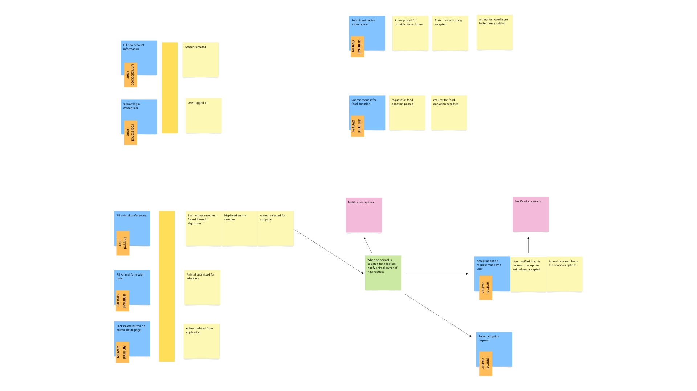
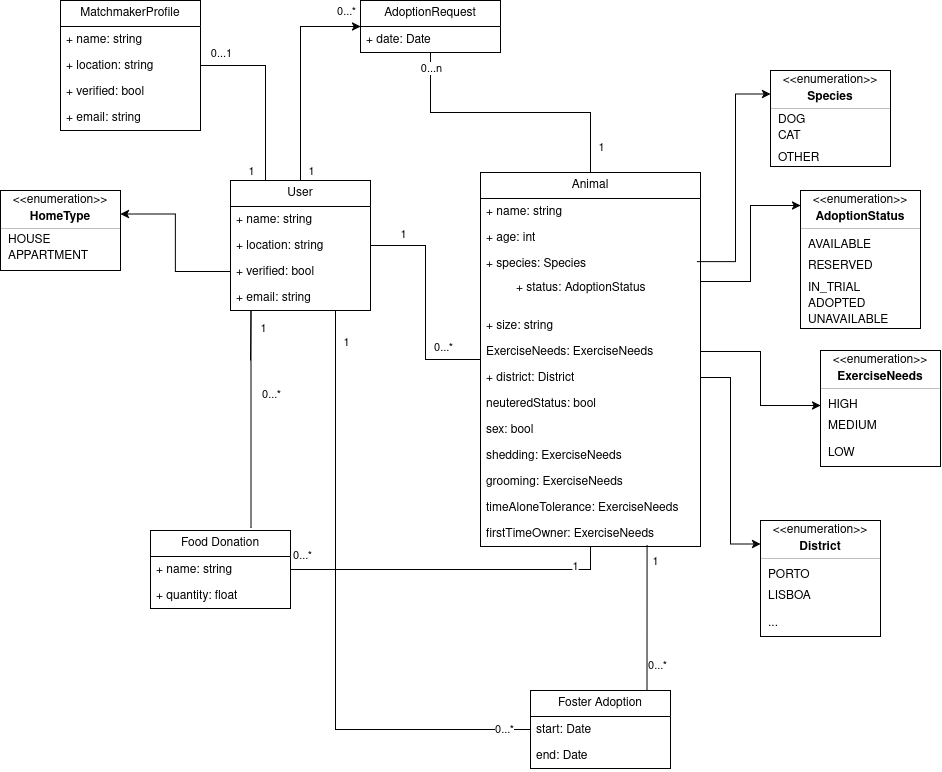
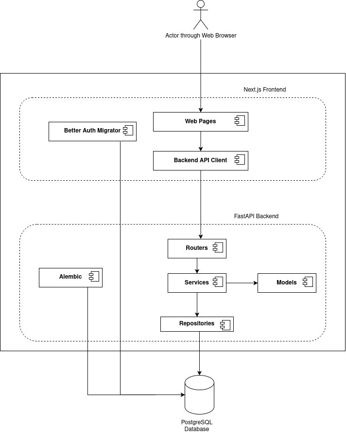
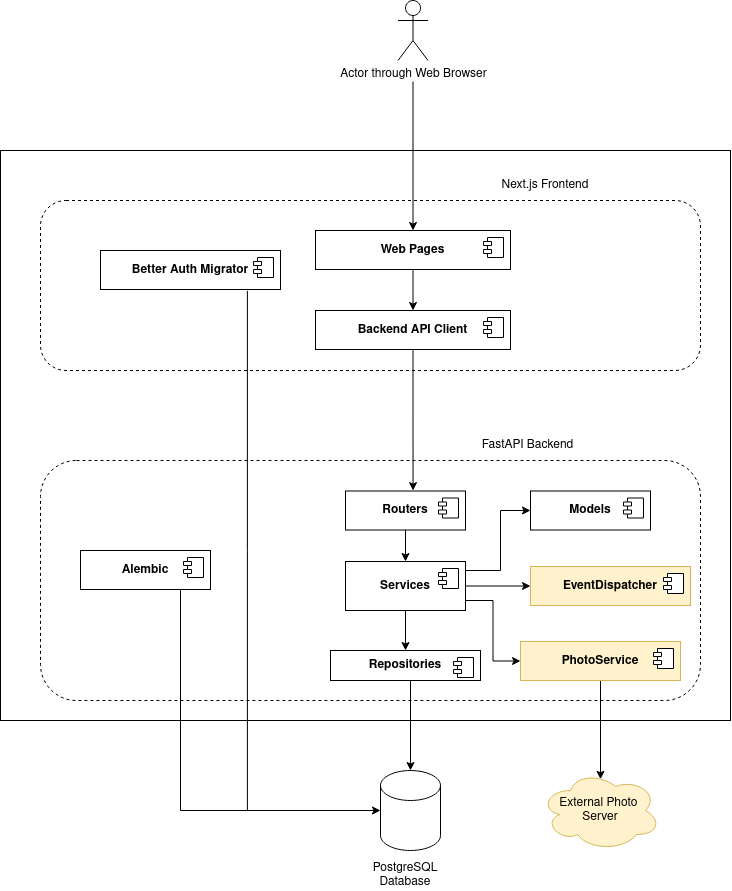

# Object Oriented Design Deliverables

## Iteration 0
### Domain Model ([link](design/OOD_deliverables/it0_ClassDiagram.png))

### Component Diagram ([link](design/OOD_deliverables/it0_ComponentDiagram.png))

### Event Storming ([link](design/OOD_deliverables/it0_EventStorming.svg))

 

## Iteration 1

### Domain model (updated) ([link](design/OOD_deliverables/it1_ClassDiagram.png))

### Component diagram (updated) ([link](design/OOD_deliverables/it1_ComponentDiagram.png))

### Future change scenario

> Identify and document one plausible future change scenario, do a coupling and cohesion analysis of the scenario, and make an explicit design decision.

#### Change scenario

Patas will start supporting animal shelters as separate entities that can publish 
animals and participate in adoptions in their own name. Shelter employees use individual 
accounts and act on behalf of their shelter, while Matchmaker profiles remain associated 
with individual users rather than shelters.

#### Coupling and cohesion

Currently, animals are owned by users, and each Matchmaker profile belongs to one user.
Changing ownership to include shelters is **model coupling**, which would have a considerable
**distance**, as the animal and user models are in separate subpackages under
`models`. It has expected **high volatility** as ownership and permissions are
reworked, but after the change, it should see no big changes for some time. 
Scattering shelter checks across animal, adoption, and account logic
would reduce cohesion and duplicate volatile rules.

#### Design decision

For the scope of the curricular unit, making shelters a separate entity will not be implemented
but if the product was to continue development, it would be a useful feature,
as it would also pave the way for the implementation of verified and trustworthy
institutions, not just regular users. 
If implemented, shelters would be separate entities with a many to many association to users as employees. Animal ownership would identify the shelter, while recording which employee acted on its behalf. We would assume that a employee account cannot adopt pets for themselves, for that they would need to create a different, personal account.

## Iteration 2

### Domain model (updated) ([link](design/OOD_deliverables/it2_ClassDiagram.png))

### Component diagram (updated) ([link](design/OOD_deliverables/it2_ComponentDiagram.png))

### Future change scenario

> Identify and document one plausible future change scenario, do a coupling and cohesion analysis of the scenario, and make an explicit design decision.

#### Change scenario

The adoption process will be extended with a trial week: after the owner accepts an application, the adopter hosts the animal for a week before the adoption is finalized. If the trial succeeds, the adoption is confirmed; if either party ends it early, the animal becomes available again. Matchmaker profiles and compatibility scoring remain unaffected.

#### Coupling and cohesion

The adoption state machine uses the State pattern in `models/adoption/state.py`, with each status as a separate subclass.
Adding a trial phase is a natural extension of this pattern (**behavioral coupling**) and would have a **short distance**,
since the state classes live in the same module. The change has **moderate volatility** as new transitions
(trial start, trial completion, trial cancelation) are added, but once settled, the state machine should be stable.
The `Animal` aggregate would not need a new status, as the animal stays `RESERVED` during the trial.
Scattering trial logic outside the State pattern would reduce cohesion and duplicate transition rules.

#### Design decision

For the scope of the curricular unit, we believe the trial week will not be implemented, but it would be a useful
quality-of-life feature if the product continued development, as it reduces failed adoptions by giving
both parties time to verify compatibility.
If implemented, a new `TRIAL` status would be added to the `ApplicationStatus` enum with a matching
`TrialState` subclass in the State pattern hierarchy. The `Animal` aggregate would remain unchanged,
keeping the animal as `RESERVED` throughout the trial. Trial completion would reuse the existing
handover confirmation flow, and early cancelation would follow the existing decline/withdraw paths.
