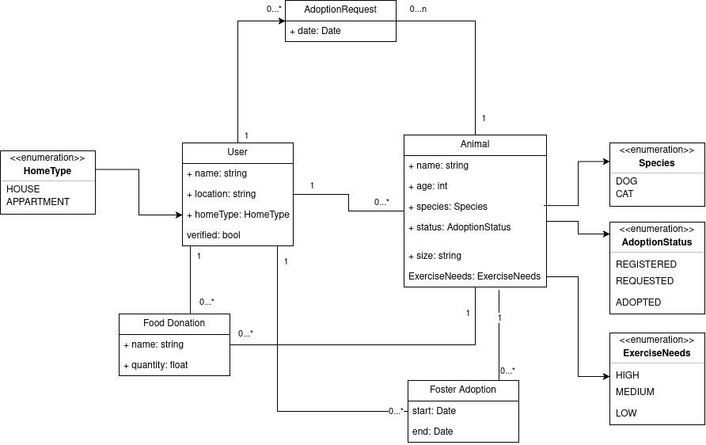
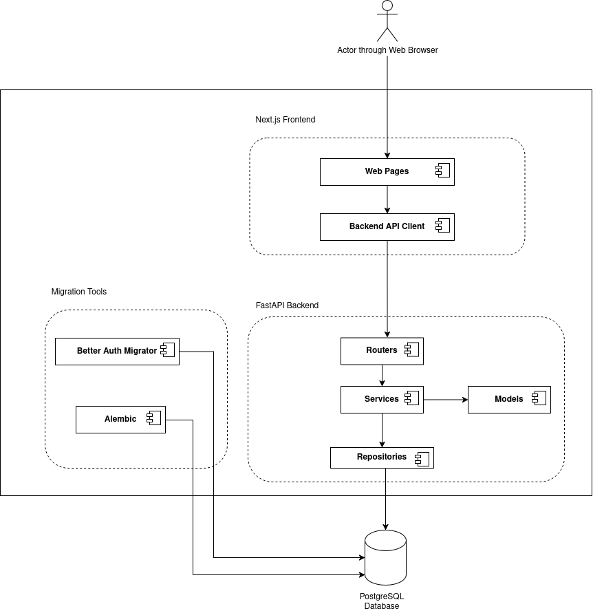
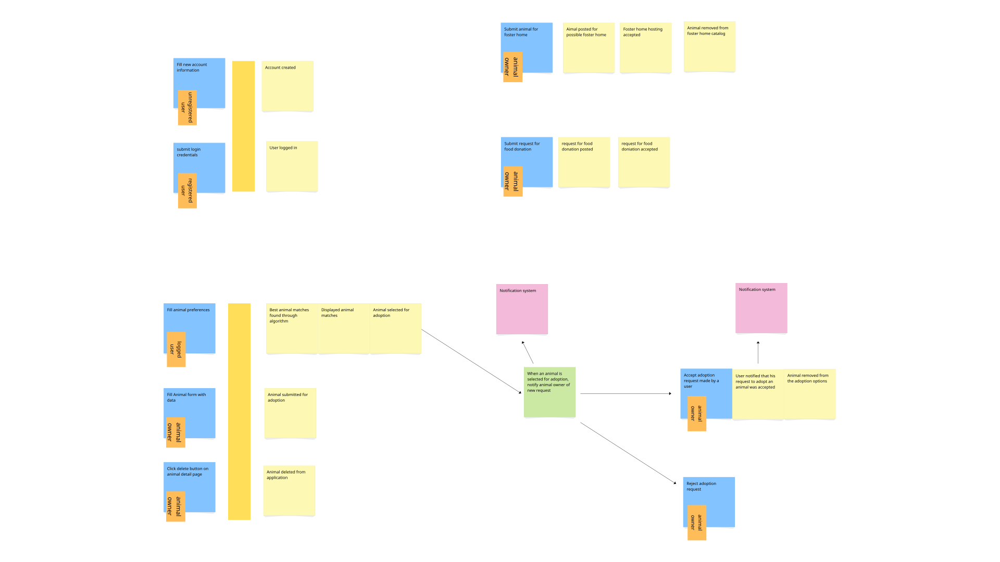
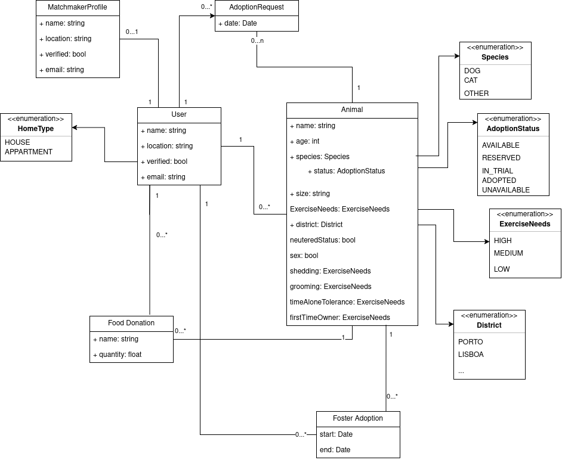
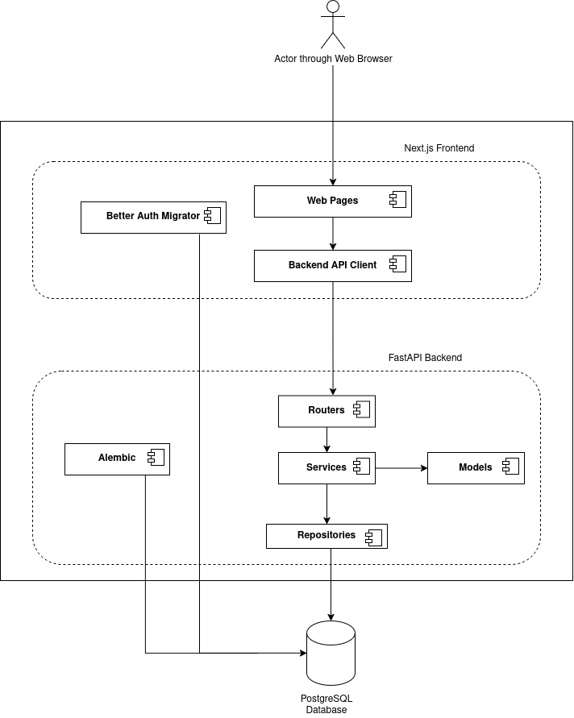

# Object Oriented Design Deliverables

## Iteration 0
### Domain Model ([link](design/OOD_deliverables/it0_ClassDiagram.png))

### Component Diagram ([link](design/OOD_deliverables/it0_ComponentDiagram.png))

### Event Storming ([link](design/OOD_deliverables/it0_EventStorming.svg))

 

## Iteration 1

### Domain model (updated) ([link](design/OOD_deliverables/it1_ClassDiagram.png))

### Component diagram (updated) ([link](design/OOD_deliverables/it1_ComponentDiagram.png))

### Future change scenario

> Identify and document one plausible future change scenario, do a coupling and cohesion analysis of the scenario, and make an explicit design decision.

#### Change scenario

Patas will start supporting animal shelters as separate entities that can publish 
animals and participate in adoptions in their own name. Shelter employees use individual 
accounts and act on behalf of their shelter, while Matchmaker profiles remain associated 
with individual users rather than shelters.

#### Coupling and cohesion

Currently, animals are owned by users, and each Matchmaker profile belongs to one user.
Changing ownership to include shelters is **model coupling**, which would have a considerable
**distance**, as the animal and user models are in separate subpackages under
`models`. It has expected **high volatility** as ownership and permissions are
reworked, but after the change, it should see no big changes for some time. 
Scattering shelter checks across animal, adoption, and account logic
would reduce cohesion and duplicate volatile rules.

#### Design decision

For the scope of the curricular unit, making shelters a separate entity will not be implemented
but if the product was to continue development, it would be a useful feature,
as it would also pave the way for the implementation of verified and trustworthy
institutions, not just regular users. 
