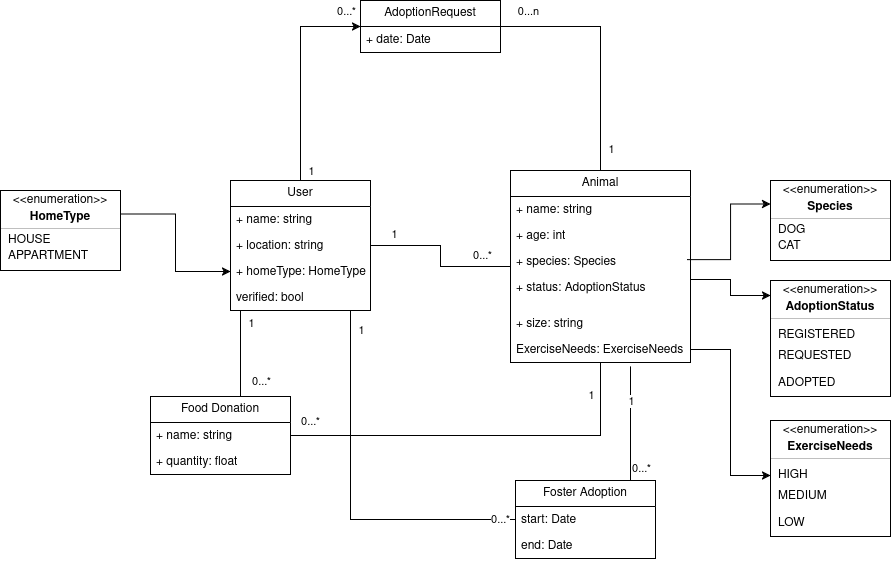
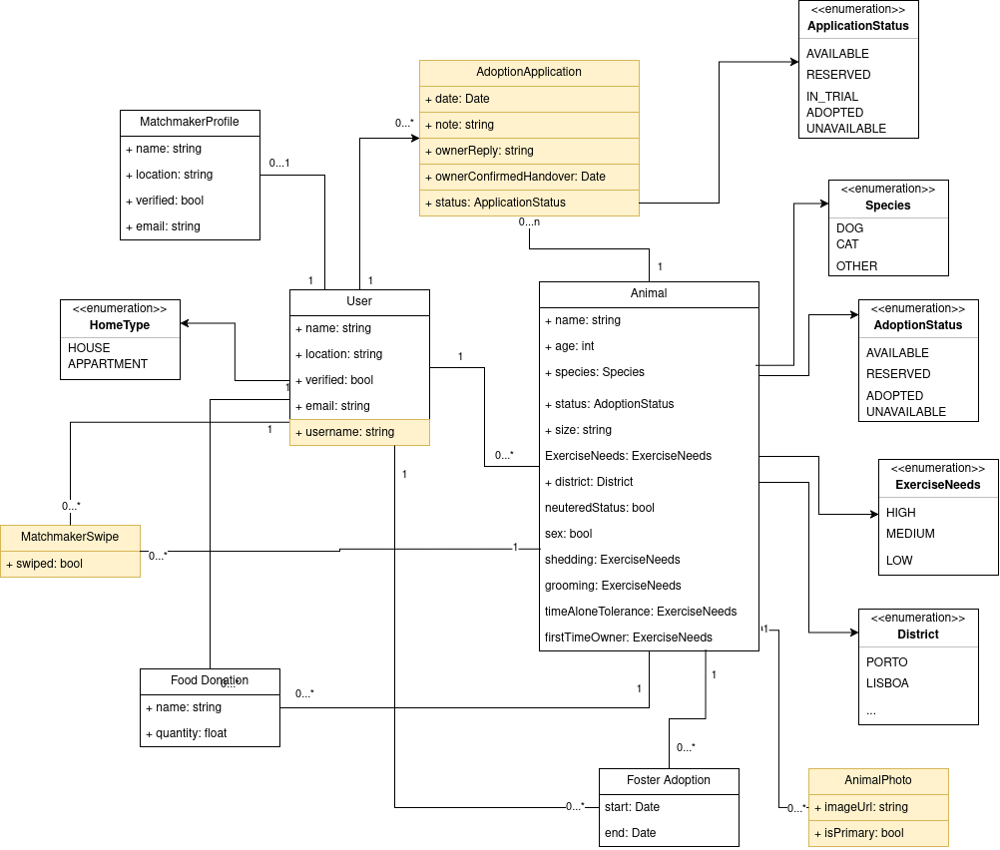
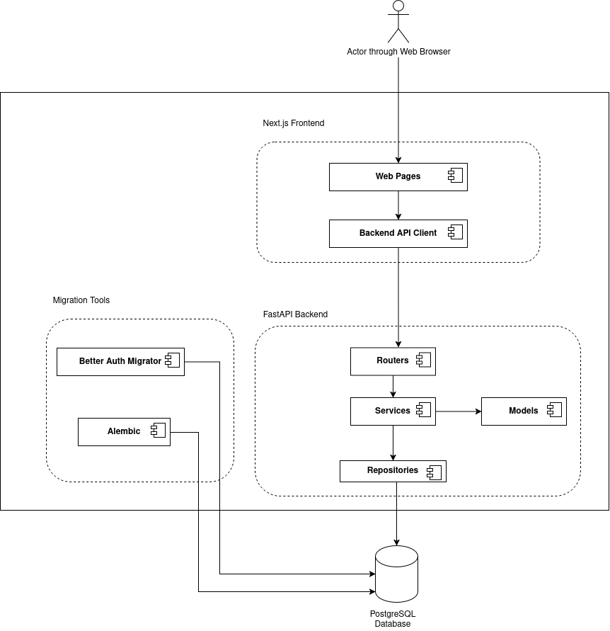

# Design Report — Patas

<!--
Keep this report in docs/design.md and update it throughout the semester.
Replace all placeholders and remove these comments as you complete the relevant sections.
Make every referenced model, diagram, and code location accessible from this report.
Sections 4–6 are completed progressively, according to the iteration schedule.
-->

## 1. Project overview

Patas is a **peer-to-peer animal adoption platform** that connects people who want to adopt an animal with individuals publishing animals for adoption. The entire adoption journey. From discovering an animal through the public catalog, assessing compatibility with the **Matchmaker** lifestyle quiz, sending an adoption request, communicating via private conversation, to confirming the final handover.

The system's central responsibilities are: maintaining a public, filterable animal catalog; computing and explaining compatibility scores between animals and household lifestyles; orchestrating the adoption application lifecycle with its state machine; providing private, participant-only conversations with request cards and guidelines; and tracking every status change through an Adoption Tracker with in-app and email notifications.

## 2. Domain discovery and modeling

### 2.1. EventStorming results

[Event Storming](design/OOD_deliverables/it0_EventStorming.svg)

The EventStorming workshop helped establish the most important processes and features of the application. The main notes were:

- Adoption lifecycle is the central process of the application, and we should focus most of the work on it.
- We have many overlapping roles, as the user who publishes an animal can also adopt one.
- The main distinctive feature of our application is the matchmaking feature, so it should be a polished feature and important for the MVP.
- The EventStorming board included foster homes and food donations from the long-term vision. For the MVP, these were identified as out of scope, clarifying that the initial model focuses on the peer-to-peer adoption flow only. The `FosterAdoption` and `FoodDonation` concepts remain in the diagrams as markers for future iterations.

Key business rules discovered during EventStorming:
- Multiple open adoption applications can exist for the same animal simultaneously, but at most one can be accepted at a time.
- When an application is accepted, the animal becomes `Reserved`; other open applications remain but cannot be accepted until the animal is `Available` again.
- The adoption is finalized only when both the owner and the applicant confirm the handover.
- The animal's `Adopted` status is final in the MVP — an adopted animal cannot return to the same listing.

Key assumptions about the product:
- The platform operates as a peer-to-peer marketplace without shelter or institutional accounts in the MVP.
- The conversation between owner and applicant is the primary screening mechanism, replacing formal interview processes found in shelter adoptions.
- Adoption is not a sale: the platform enforces this rule through guidelines and moderation, not through legal contracts.

### 2.2. Domain model

**Iteration 0:** [Class Diagram](design/OOD_deliverables/it0_ClassDiagram.png)

**Iteration 1:** [Class Diagram](design/OOD_deliverables/it1_ClassDiagram.png)

**Iteration 2:** [Class Diagram](design/OOD_deliverables/it2_ClassDiagram.png)

The domain model evolved across iterations as understanding of the problem deepened. The core concepts are:

- **User** is the central actor. A single `User` can publish animals (acting as an owner) and apply to adopt other users' animals (acting as an adopter).
- **Animal** represents a published animal listing. It carries identity attributes (`name`, `species`, `age`, `size`, `sex`), location (`district`), and a rich compatibility profile (`exerciseNeeds`, `shedding`, `grooming`, `timeAloneTolerance`, `firstTimeOwner`, `neuteredStatus`). The animal's lifecycle is followed by the `AdoptionStatus` enum (`AVAILABLE`, `RESERVED`, `ADOPTED`, `UNAVAILABLE`), which tracks whether it can be adopted.
- **AdoptionApplication** (renamed from `AdoptionRequest` in iteration 2) represents an adopter's request for a specific animal. It records the applicant's note, the owner's reply, handover confirmation, and the current `ApplicationStatus` (`OPEN`, `ACCEPTED`, `DECLINED`, `WITHDRAWN`, `CLOSED`, `ADOPTED`). Multiple open applications can exist for the same animal, but at most one can be accepted at a time.
- **MatchmakerProfile** stores a user's saved lifestyle preferences (household composition, energy level, space) used to compute compatibility scores against animals. It is optional and is linked to the user with a `0..1` multiplicity.
- **Enumerations** capture domain vocabulary: `Species` (dog, cat, other), `District` (Porto, Lisboa, etc.), `ExerciseNeeds` (high, medium, low), `HomeType` (house, apartment), `AdoptionStatus`, and `ApplicationStatus`.

Key modeling choices: 
- The same `User` type serves both owner and adopter roles, avoiding unnecessary inheritance. 
- The compatibility profile on `Animal` uses the `ExerciseNeeds` enum for multiple attributes, for simplicity and code reusability.
-  `MatchmakerProfile` is a separate entity rather than embedded in `User`, allowing it to evolve independently (e.g., with swiping behavior via `MatchmakerSwipe` in iteration 2).

## 3. High-level architecture

**Iteration 0:** [Component Diagram](design/OOD_deliverables/it0_ComponentDiagram.png)

**Iteration 1:** [Component Diagram](design/OOD_deliverables/it1_ComponentDiagram.png)

**Iteration 2:** [Component Diagram](design/OOD_deliverables/it2_ComponentDiagram.png)

The system is divided into four main components that collaborate through well-defined boundaries:

- **Next.js Frontend** runs in the user's browser and renders the web interface. It contains *Web Pages* (screens and components for the catalog, animal profiles, Matchmaker quiz, adoption tracker, and conversations) and a *Backend API Client* that sends HTTP requests to the FastAPI backend. The frontend also includes the *Better Auth Migrator*, which creates and updates the authentication tables in the `patas_auth` schema of the database. The frontend is stateless: all domain logic and data persist on the backend.

- **FastAPI Backend** exposes a RESTful API and implements all domain logic. Requests flow through *Routers* (endpoint definitions and request/response serialization), then to *Services* (use-case orchestration and business rules), which operate on *Models* (domain entities, value objects, and the adoption state machine). *Repositories* provide abstracted database access, isolating the domain from SQL and SQLAlchemy details. From iteration 2, the backend also includes an *EventDispatcher* for domain events (e.g., status changes triggering notifications) and a *PhotoService* for uploading and serving animal photos through an external photo server. This layered structure within the backend ensures that domain models remain independent of framework concerns.

- **Migration Tools** manage the database schema. *Alembic* handles the backend domain tables (animals, applications, users, etc.), while the *Better Auth Migrator* manages the authentication schema. Both run as one-off commands during setup or deployment, not as part of the running application. Separating migration tools from the application ensures schema changes are versioned, reversible, and auditable.

- **PostgreSQL Database** is the single source of persistent data, storing both domain data and authentication records. From iteration 2, an *External Photo Server* provides dedicated object storage for uploaded photos, decoupling file storage from the relational database.

The main architectural boundary is between the frontend and backend: the frontend handles presentation and user interaction, while the backend owns all domain logic, state transitions, and data consistency rules. Within the backend, the router -> service -> repository flow enforces a clear separation between HTTP concerns, business logic, and data access.

## 4. Future change scenarios: coupling, cohesion, and design decisions

<!-- Repeat the subsection below for each pattenr instance -->

**Date:** 2026-11-03

### 4.1. Scenario 1 — Shelter Support (Iteration 1)

#### Change scenario and design context

Patas will start supporting animal shelters as separate entities that can publish
animals and participate in adoptions in their own name. Shelter employees use individual
accounts and act on behalf of their shelter, while Matchmaker profiles remain associated
with individual users rather than shelters.

#### Coupling and cohesion analysis

Currently, animals are owned by users, and each Matchmaker profile belongs to one user.
Changing ownership to include shelters is **model coupling**, which would have a considerable
**distance**, as the animal and user models are in separate subpackages under
`models`. It has expected **high volatility** as ownership and permissions are
reworked, but after the change, it should see no big changes for some time.
Scattering shelter checks across animal, adoption, and account logic
would reduce cohesion and duplicate volatile rules.

#### Alternatives, decision, and consequences

For the scope of the curricular unit, making shelters a separate entity will not be implemented
but if the product was to continue development, it would be a useful feature,
as it would also pave the way for the implementation of verified and trustworthy
institutions, not just regular users.
If implemented, shelters would be separate entities with a many to many association to users as employees. Animal ownership would identify the shelter, while recording which employee acted on its behalf. We would assume that a employee account cannot adopt pets for themselves, for that they would need to create a different, personal account.

**Date:** 2026-11-15

### 4.2. Scenario 2 — Adoption Trial Week (Iteration 2)

#### Change scenario and design context

The adoption process will be extended with a trial week: after the owner accepts an application, the adopter hosts the animal for a week before the adoption is finalized. If the trial succeeds, the adoption is confirmed; if either party ends it early, the animal becomes available again. Matchmaker profiles and compatibility scoring remain unaffected.

#### Coupling and cohesion analysis

The adoption state machine uses the State pattern in `models/adoption/state.py`, with each status as a separate subclass.
Adding a trial phase is a natural extension of this pattern (**behavioral coupling**) and would have a **short distance**,
since the state classes live in the same module. The change has **moderate volatility** as new transitions
(trial start, trial completion, trial cancelation) are added, but once settled, the state machine should be stable.
The `Animal` aggregate would not need a new status, as the animal stays `RESERVED` during the trial.
Scattering trial logic outside the State pattern would reduce cohesion and duplicate transition rules.

#### Alternatives, decision, and consequences

For the scope of the curricular unit, we believe the trial week will not be implemented, but it would be a useful
quality-of-life feature if the product continued development, as it reduces failed adoptions by giving
both parties time to verify compatibility.
If implemented, a new `TRIAL` status would be added to the `ApplicationStatus` enum with a matching
`TrialState` subclass in the State pattern hierarchy. The `Animal` aggregate would remain unchanged,
keeping the animal as `RESERVED` throughout the trial. Trial completion would reuse the existing
handover confirmation flow, and early cancelation would follow the existing decline/withdraw paths.

## 5. Existing design pattern instances

<!-- Repeat the subsection below for each pattern instance -->

### 5.1. [Name the design challenge] — [Pattern name]

#### Problem in context

#### The pattern: selection and implementation

**Pattern and rationale.** 

**Mapping to the implementation.** 

| Pattern role | Concrete implementation | Explanation |
| --- | --- | --- |
| [Pattern element] | [Relevant class, interface, and method names, linked to the relevant code] | [An explanation of the roles and implementation, when needed] |

**Illustration:** 

#### Consequences and alternatives

## 6. Existing code smells and possible refactorings

<!-- Repeat the subsection below for each pattern instance -->

### 6.1. [Code smell name]

**Location and evidence.**

**Design consequences.** 

**Possible refactoring.** 

**Implementation status (if applicable).** 
