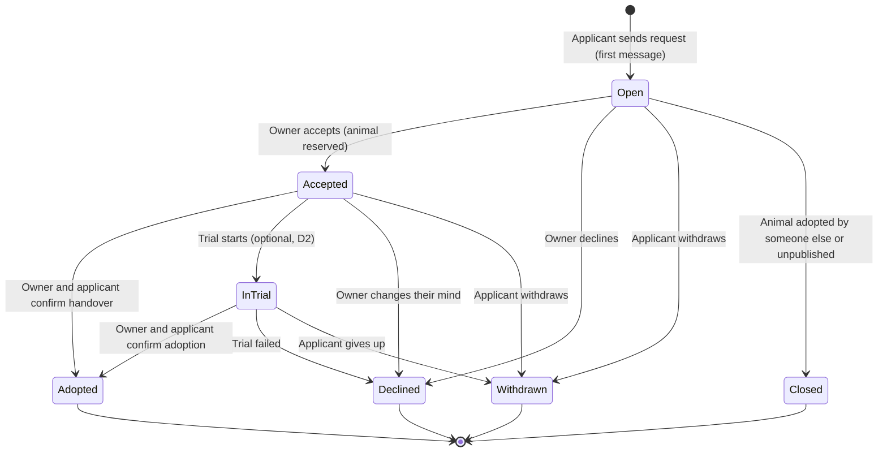
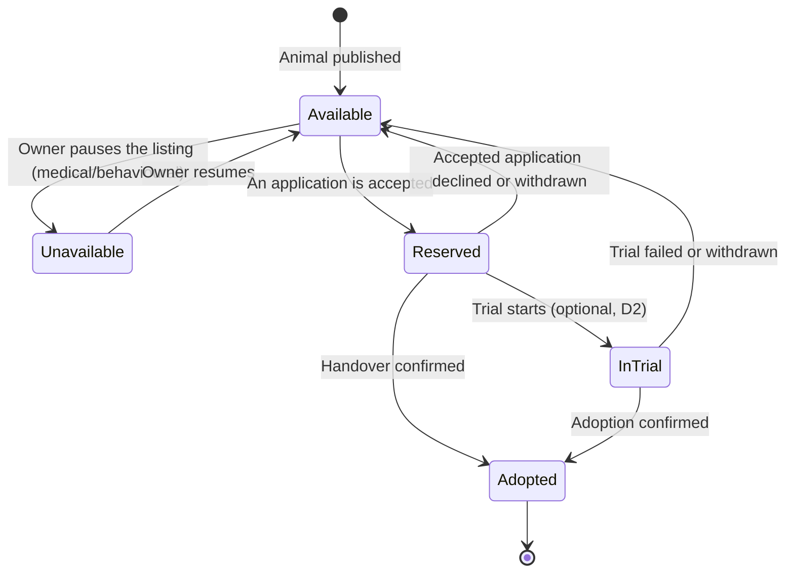

# Adoption Pipeline

> **Status: Proposed.** Awaiting team alignment (`AGENTS.md` §6). Open decisions are listed in [section 10](#10-open-decisions).
>
> This document replaces `StateMachines.md`, which described the long-term [Vision](../product/Vision.md) (associations, fostering, location, wishlist, verification). It can still be read in the git history.

## 1. Why

* `StateMachines.md` was written for the Vision. The [MVP](../product/MVP.md) dropped most of its machines (associations, location, fostering, wishlist, verification).
* The adoption application (8 states: `Submitted`, `Screening`, `Interview`, `OnHold`, ...) was modelled on a shelter, where staff screen and interview applicants. In the MVP's peer-to-peer marketplace there is no staff. Owner and applicant got to know each other **off the platform**, after contact details were revealed at `Interview`. Chat was deferred.
* **Goal:** the whole adoption happens inside Patas. The pipeline stays small, and **the conversation is the screening**: the owner gets to know the applicant by talking and seeing photos of the home, not by reading a long form.

## 2. The Journey

| # | Step | What happens |
| :-: | :-- | :-- |
| 1 | **Discover** | Catalog, Matchmaker score, animal profile |
| 2 | **Request** | The applicant writes a first message. Their Matchmaker profile is attached automatically. The application is `Open`. |
| 3 | **Get to know** | Chat, photos of the home, request cards from the owner, guidelines panel ([section 6](#6-the-conversation)) |
| 4 | **Accept** | The owner picks one applicant and the animal becomes `Reserved` |
| 5 | **Meet and hand over** | Arranged in the chat. Optional trial ([decision D2](#10-open-decisions)). |
| 6 | **Adopted** | Both sides confirm the handover ([section 8](#8-handover)) |

## 3. Adoption Application

Rules:

* **Several applicants can be `Open` for the same animal** at the same time (D3). Each one has its own conversation with the owner.
* **At most one application per animal** can be `Accepted` or `InTrial`. While the animal is reserved, the other `Open` applications continue (the chat stays open) but cannot be accepted. Reservation is enforced by the animal's status, so no `OnHold` state is needed.
* An applicant has at most one active application (`Open`, `Accepted`, `InTrial`) per animal.
* An owner cannot apply to their own animal.
* New requests are accepted only while the animal is `Available`.
* Every transition creates a `StatusChange` entry (the Adoption Tracker timeline), a system message in the conversation and a notification.

## 4. Animal Adoption Status (MVP)

* `Adopted` is final for the listing in the MVP (D5).
* There is no location dimension (see ADR 0004): the animal is with the adopter when it is `InTrial` or `Adopted`.

## 5. Cross-Aggregate Rules

`Animal` and `AdoptionApplication` are separate aggregates. They are coordinated through domain events (Observer).

| Event | Reaction |
| :-- | :-- |
| Application `Accepted` | Animal `Available → Reserved` |
| Accepted application `Declined` / `Withdrawn` | Animal `Reserved → Available`; the other `Open` applications can be accepted again |
| Trial starts | Application `Accepted → InTrial`; animal `Reserved → InTrial` |
| Trial failed / withdrawn | Animal `InTrial → Available` |
| Adoption confirmed | Animal `→ Adopted`; all other `Open` applications `→ Closed` |
| Animal unpublished | All `Open` applications `→ Closed` |
| Any application transition | `StatusChange` entry, system message in the chat, notification (in-app and email) |
| Message posted | Notification to the other participant |

## 6. The Conversation

Each application has exactly **one conversation**. There are no free direct messages between users.

* **Participants:** the applicant and the animal's owner. Nobody else can read or post.
* **Lifetime:** opens with the request; becomes read-only when the application reaches a final state (`Adopted`, `Declined`, `Withdrawn`, `Closed`).
* **Message kinds:**
  * *Text*
  * *Photo* (see [section 7](#7-photos))
  * *Request card*: sent by the owner with one tap, answered by the applicant. Initial set: "Send photos of your home", "Send photos of your other pets", "Propose a time to meet" (date, time and place).
  * *System message*: Matchmaker profile card at the start, status changes, handover confirmations.
* **Guidelines panel** next to the chat, advisory only, never blocking: suggested questions for the owner (who lives in the home, outdoor space, hours alone, experience), safety tips (meet in a public place first) and the platform rule that **adoption is not a sale**.
* **Report** on any message, handled by moderation (A7).
* **Contact details are never shown by the platform.** Everything needed happens in the conversation.

## 7. Photos

* Visible **only to the two participants** of the conversation. No public URLs: files are served after an authorization check or through short-lived signed links.
* On upload: allowed types JPEG, PNG and WebP; size limit; the image is re-encoded and **EXIF metadata is removed** (phone photos carry GPS coordinates, which would reveal the applicant's address).
* Kept for a limited time after the application closes (D6), then deleted (GDPR data minimisation).
* Stored in the same storage as the animal photos (storage ADR, iteration 2).

## 8. Handover

While the application is `Accepted` or `InTrial`, the conversation shows a **handover checklist** (advisory):

* Vaccination booklet handed over
* Microchip ownership transferred in SIAC
* Notes on food, habits and routines
* Acknowledgement of the adoption terms (adoption, not sale). Not a legal contract (out of scope).

The adoption is completed only when **both** sides confirm: the owner ("I handed over the animal") and the applicant ("I received the animal").

## 9. Implementation Notes (to confirm in ADRs)

* **State pattern:** one class per application state (`OpenState`, `AcceptedState`, `InTrialState`, `AdoptedState`, `DeclinedState`, `WithdrawnState`, `ClosedState`) exposing `accept()`, `decline()`, `withdraw()`, `start_trial()`, `confirm_handover()`, `close()` and `can_post_message()`. An invalid operation raises a domain exception. The animal keeps one state object (section 4).
* **Observer:** `ApplicationStatusChanged` and `MessagePosted` events feed notifications and system messages.
* **Chat transport:** REST + polling first; Server-Sent Events with Postgres `LISTEN/NOTIFY` later (the same channel can carry notifications). Needs an ADR.

## 10. Open Decisions

| ID | Question | Proposal |
| :-- | :-- | :-- |
| D1 | Replace the 8-state application machine with this one? | Yes |
| D2 | Keep the optional trial (`InTrial`) or drop it? | Team call. Dropping it removes `InTrial` from both machines and from the `adoption_status` enum. |
| D3 | Several applicants `Open` for the same animal at once? | Yes, only one `Accepted` |
| D4 | Can the owner make a request card mandatory before accepting (e.g. home photos)? | No, advisory only |
| D5 | Is `Adopted` final, or can an adopted animal be returned to the same listing? | Final in the MVP |
| D6 | How long are conversation photos kept after the application closes? | To decide (e.g. 30 days) |
| D7 | Chat transport | Polling first, SSE later (ADR) |

## 11. Impact on Other Documents

* `StateMachines.md`: **removed** (git history).
* [MVP](../product/MVP.md): already lists the chat-based adoption; adjust it if the team changes this proposal.
* `database/create.sql`: the `application_status` enum is outdated (the file is not authoritative; migrations are).
